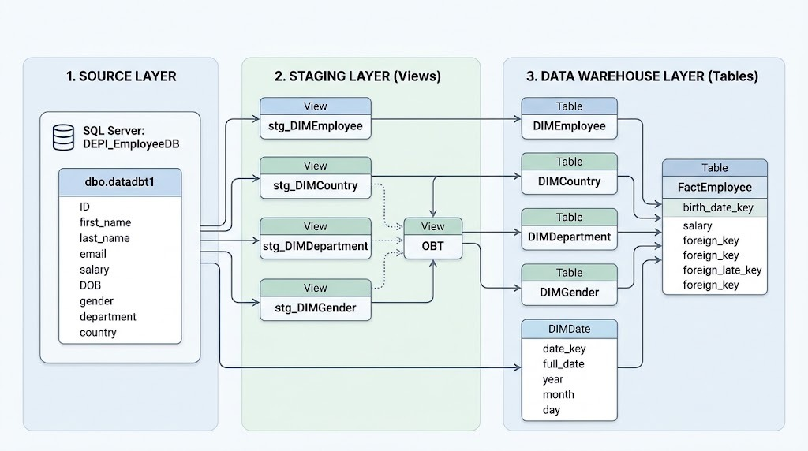

# DEPI Employee Data Warehouse - dbt + SQL Server

A data warehouse project built with **dbt Core, SQL Server, and Python tooling** as part of the DEPI assignment. The project transforms raw employee data into staging models and a dimensional data warehouse for analytical reporting.

## Architecture



The project is organized into three main parts:

- **Source:** Raw employee data stored in SQL Server.
- **Staging:** Views that prepare and organize source data.
- **Data Warehouse (DWH):** Dimension and fact tables designed for analytical queries.

> **Note:** The architecture diagram should reflect the current implementation of the project, including the `DIMDate` dimension and its relationship with `FactEmployee`.

## Data Source

The project uses the following source table:

| Property | Value |
|---|---|
| Database | `DEPI_EmployeeDB` |
| Schema | `dbo` |
| Table | `datadbt1` |
| dbt source name | `employee_source` |

The source contains employee attributes such as ID, name, email, salary, date of birth, gender, department, and country.

The source is configured in `models/sources.yml`.

## Project Structure

```text
depi_employee_dbt/
|-- models/
|   |-- staging/
|   |   |-- stg_DIMEmployee.sql
|   |   |-- stg_DIMCountry.sql
|   |   |-- stg_DIMDepartment.sql
|   |   |-- stg_DIMGender.sql
|   |   |-- OBT.sql
|   |   `-- schema.yml
|   |-- dwh/
|   |   |-- DIMEmployee.sql
|   |   |-- DIMCountry.sql
|   |   |-- DIMDepartment.sql
|   |   |-- DIMGender.sql
|   |   |-- DIMDate.sql
|   |   |-- FactEmployee.sql
|   |   `-- schema.yml
|   `-- sources.yml
|-- macros/
|   `-- clean_string.sql
|-- tests/
|   |-- staging/
|   `-- dwh/
|-- docs/
|   `-- schema.png
|-- dbt_project.yml
|-- pyproject.toml
`-- uv.lock
```

## Data Modeling

### 1. Staging Layer

The staging layer contains views that prepare source data for downstream models.

| Model | Purpose |
|---|---|
| `stg_DIMEmployee` | Selects and cleans employee attributes. |
| `stg_DIMCountry` | Prepares distinct country values. |
| `stg_DIMDepartment` | Prepares distinct department values. |
| `stg_DIMGender` | Prepares distinct gender values. |
| `OBT` | Combines source employee information with staging dimension identifiers. |

String cleaning is handled using the reusable `clean_string` macro.

There is no separate `stg_employees` model in this project.

### 2. Data Warehouse Layer

The DWH layer contains the dimension and fact tables used for analysis.

#### Dimension Tables

| Model | Description |
|---|---|
| `DIMEmployee` | Employee dimension and employee attributes from staging. |
| `DIMCountry` | Country dimension for geographical analysis. |
| `DIMDepartment` | Department dimension for organizational analysis. |
| `DIMGender` | Gender dimension for employee analysis. |
| `DIMDate` | Date dimension containing distinct, non-null employee birth dates and their calendar attributes. |

The `DIMDate` model includes:

- `date_key`: Integer date key in `YYYYMMDD` format.
- `full_date`: Full birth date.
- `year`: Calendar year.
- `month`: Calendar month number.
- `day`: Day of the month.

This implementation provides date attributes for birth-date analysis. It contains distinct dates found in the source data rather than a complete calendar of every date.

#### Fact Table

**`FactEmployee`** connects employee records to the relevant dimension tables.

Its columns include:

| Column | Description |
|---|---|
| `id` | Generated fact-table row identifier. |
| `id_dimemployee` | Employee dimension key. |
| `id_dimcountry` | Country dimension key. |
| `id_dimgender` | Gender dimension key. |
| `id_dimdepartment` | Department dimension key. |
| `birth_date_key` | Date dimension key matched using the employee's `DOB`. |
| `salary` | Employee salary from the source. |

The model uses left joins to retain source employee rows even when a corresponding dimension record is unavailable. In that case, the related dimension key may be `NULL`.

## Data Quality and Testing

The project uses dbt tests to validate model data quality.

### Generic Tests

Generic tests are declared in model YAML files, including:

- `unique`
- `not_null`

These tests validate uniqueness and required values for the configured columns.

### Singular Tests

Custom SQL tests are stored under the `tests/` directory. They cover business rules such as checking that salary is not negative and validating fact-table dimension-key relationships.

A singular test passes when its query returns no rows.

## Prerequisites

Before running the project, install and configure:

- Python version supported by `pyproject.toml`
- [uv](https://docs.astral.sh/uv/)
- SQL Server access to the configured source database and table
- dbt profile named `depi_dbt`

## Setup

### 1. Clone the Repository

```bash
git clone https://github.com/Hbiba4/DBT.git
cd DBT
```

### 2. Install Dependencies

```bash
uv sync
```

### 3. Configure the dbt Profile

Configure the profile locally at:

- Windows: `%USERPROFILE%\.dbt\profiles.yml`
- Other systems: `~/.dbt/profiles.yml`

The profile should use the `depi_dbt` name and match your SQL Server connection settings.

**Do not commit database credentials or passwords to GitHub.**

### 4. Validate the Connection

```bash
uv run dbt debug
```

### 5. Run the Models

```bash
uv run dbt run
```

### 6. Execute Tests

```bash
uv run dbt test
```

Alternatively, run models and tests together:

```bash
uv run dbt build
```

## Generate dbt Documentation

Generate the project documentation:

```bash
uv run dbt docs generate
```

Start the local documentation website:

```bash
uv run dbt docs serve
```

The generated documentation includes model descriptions, columns, tests, and lineage information based on the project's dbt metadata.

## Technologies Used

- **dbt Core** - SQL transformations, model dependencies, documentation, and testing.
- **SQL Server** - Relational database and data warehouse.
- **Python and uv** - Project environment and dependency management.
- **Git and GitHub** - Version control and project hosting.

## Project Goal

The goal is to transform raw employee data into a structured dimensional data warehouse using dbt best practices, reusable SQL transformations, documented models, and automated data quality tests.
